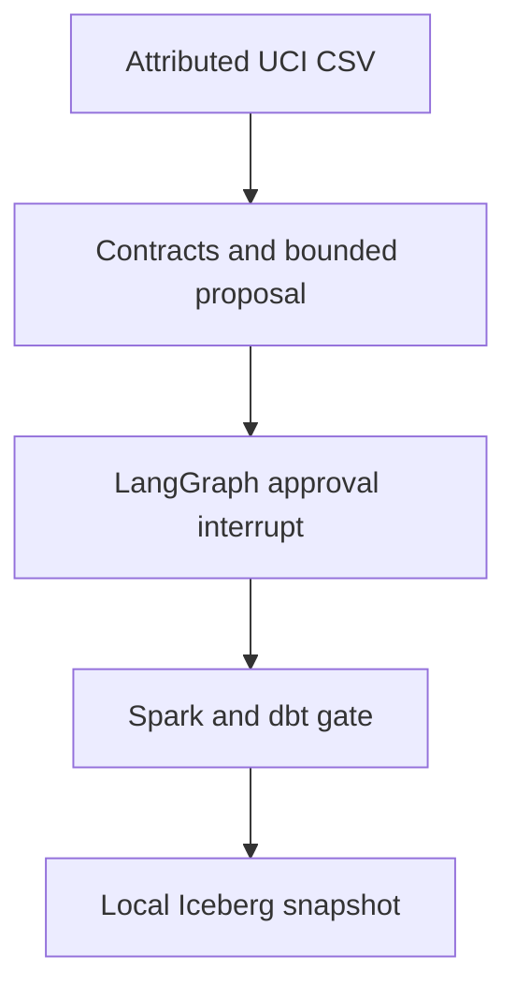

# Lakehouse Guardian

A local Spark/Iceberg data-quality workflow with dbt checks, LangGraph approval gates, and measured fault-injection evaluations on UCI Bike Sharing data.

[](https://github.com/Sunnyvulli/lakehouse-guardian/actions/workflows/verify.yml)

**Inspect in 60 seconds:** [recorded run](results/demo.json) · [fault evaluation](results/evaluation.json) · [failure analysis](docs/failure-analysis.md) · [decisions](docs/decisions.md). This is a local reference system; AWS resources have not been applied.

## Quick start

Python 3.12, Java 17, and GNU Make on Linux are the tested prerequisites. The first installation downloads Spark and scientific packages; no five-minute clean-OS promise is made.

```sh
python3 -m venv .venv
. .venv/bin/activate
pip install -r requirements.txt
make run
```

`make run` explicitly approves publication of the bundled, attributed local fixture. It executes an actual LangGraph interrupt/resume, Spark transformation, five dbt checks, and an Iceberg commit. It does not approve any cloud change. Run `python -m guardian.demo` without the approval flag to inspect the interrupted proposal with no publication. `make test eval` runs the behavioral tests and fault experiments.

## What the run demonstrates

- 17,379 real hourly observations, 731 observed dates, and 3,292,679 represented rentals; input SHA-256 and versions retained.
- Eleven behavioral tests cover contracts, schema errors, approval denial, forged proposal hashes, instruction strings, string booleans, and explicit scoped approval.
- 21 controlled batches, seeds 7/17/29: row detection precision 1.00, recall 0.80; zero alarms on three clean controls. These are designed faults on one dataset, not real-world detection accuracy.
- Spark transforms typed rows; dbt gates daily aggregates before Iceberg mutation. Repeating an identical snapshot is checked against actual table contents and returns `unchanged`.
- The first observed local run took about 15 seconds after dependency installation; timing depends on the environment. No paid model API is invoked; cloud cost is unmeasured, not zero.

## Architecture



Airflow separately orchestrates inspect → stage Spark Parquet → dbt checks → pending approval. It cannot grant approval or publish the final table. Its integration test is a real `dag.test()` run with an initialized metadata database, not just an import test. The real Airflow integration passed on GitHub’s runner. Local execution in the authoring sandbox encountered a process-visibility error; the clean CI result verifies the DAG in its recorded environment. See [operations](docs/operations.md).

## Evals and the failure worth discussing

The detector misses injected rental inflation when `casual + registered == cnt` still holds. Domain contracts detect contradictions, not observational truth. Humidity mean-shift alerts are also not seasonally adjusted. See the raw per-seed results and [failure analysis](docs/failure-analysis.md).

## Infrastructure boundary

`infra/` defines encrypted, versioned S3 storage with public access blocked and TLS required, plus a Glue catalog database. Terraform formatting/provider validation is distinct from deployment. It does **not** deploy a Glue compute job, Airflow service, identity-backed approval API, or a complete AWS lakehouse. AWS execution needs a selected account/region, scoped identity, spending limit, workload, failure/retry logs, and teardown evidence. No `apply` is run by CI.

## Limits and roadmap

The graph is a deterministic tool workflow, not a learned planner benchmark. Approval is an explicit local-operator decision bound to the proposal hash; the in-memory checkpoint is lost on restart, and local process owners are trusted. It is not an authenticated multi-user approval service. Driver collection and full-table comparison are bounded to this historical dataset. Do not infer distributed throughput or production adoption.

Next: durable approval identity/checkpoint storage, independent-source fault labels and seasonal drift calibration, then a separately approved AWS integration. First-release CI passed for the local integration, actual Airflow execution, Terraform validation and full-history scanner. AWS deployment remains pending. See [CHANGELOG](CHANGELOG.md).

## Attribution and contribution

Dataset: UCI Bike Sharing, 2011–2012, CC BY 4.0; [source/license/hash](data/SOURCE.md). Python, Spark, Iceberg, dbt, LangGraph, Airflow and Terraform libraries are used under their own licenses. This implementation is original portfolio code; established algorithms and APIs are not claimed as novel. MIT code license. [Contributing](CONTRIBUTING.md).
